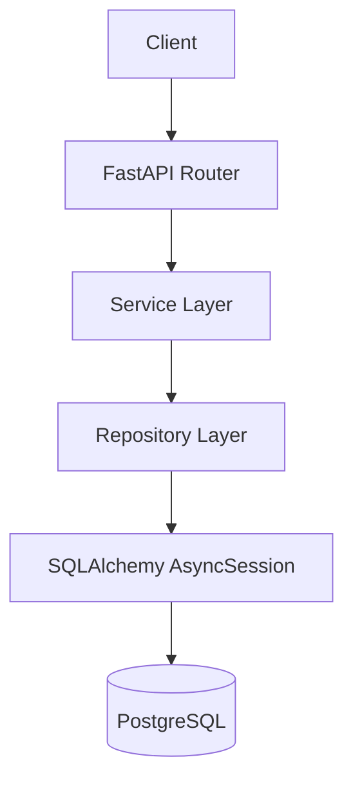
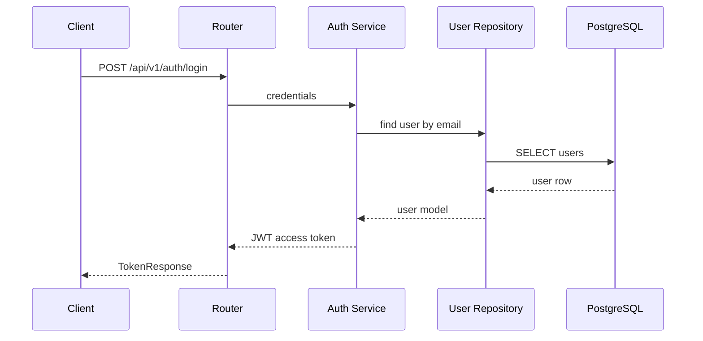
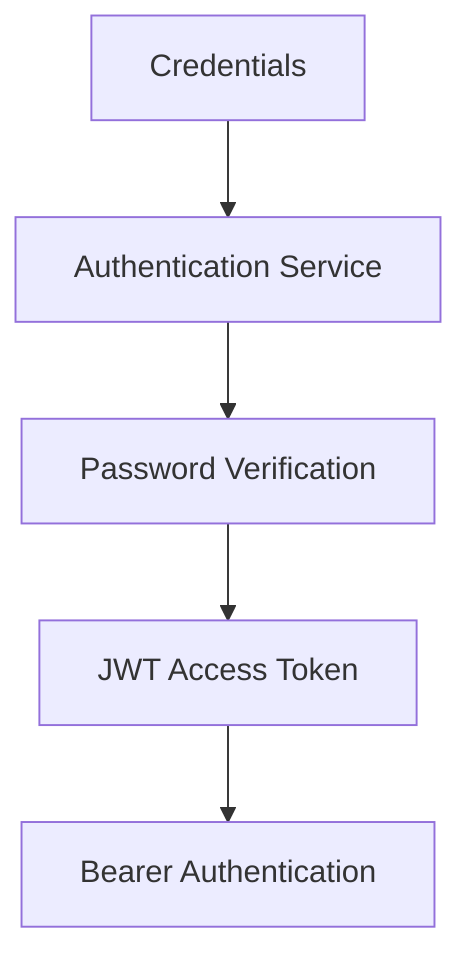

# FastAPI Production Starter

[](https://www.python.org/)
[](https://fastapi.tiangolo.com/)
[](https://www.postgresql.org/)
[](https://github.com/devanasly/fastapi-production-starter/actions/workflows/ci.yml)
[](LICENSE)

A production-oriented FastAPI starter demonstrating clean backend architecture, authentication, PostgreSQL, migrations, Docker, testing, and CI.

## Overview

This project is a pragmatic backend starter for building REST APIs with FastAPI. It keeps the architecture clear without adding unnecessary enterprise machinery: routers handle HTTP concerns, services hold business logic, repositories own data access, and SQLAlchemy manages persistence.

## Features

- FastAPI with versioned REST endpoints under `/api/v1`
- Async SQLAlchemy 2.x with PostgreSQL and `asyncpg`
- Alembic migrations using application metadata
- Pydantic v2 schemas and `pydantic-settings` configuration
- JWT bearer authentication with expiring access tokens
- Argon2 password hashing through `pwdlib`
- Centralized error responses
- Configurable CORS and logging
- Dockerfile and Docker Compose with PostgreSQL health checks
- Pytest API tests with isolated async SQLite
- Ruff linting, import sorting, and formatting
- GitHub Actions CI

## Architecture



The API layer validates HTTP input and output. The service layer coordinates authentication behavior. The repository layer encapsulates database queries.

## Request Flow



## Project Structure

```text
app/
  api/
    dependencies.py
    v1/
      endpoints/
        auth.py
        health.py
        users.py
      router.py
  core/
    config.py
    exceptions.py
    logging.py
    security.py
  db/
    base.py
    session.py
  models/
    user.py
  repositories/
    user_repository.py
  schemas/
    auth.py
    common.py
    user.py
  services/
    auth_service.py
alembic/
tests/
.github/workflows/
```

## Tech Stack

- Python 3.12+
- FastAPI
- PostgreSQL
- SQLAlchemy 2.x async ORM
- Alembic
- Pydantic v2
- PyJWT
- pwdlib with Argon2
- Pytest, HTTPX, pytest-asyncio
- Ruff
- Docker and Docker Compose

## Getting Started

Clone the repository and copy the sample environment:

```bash
git clone https://github.com/devanasly/fastapi-production-starter.git
cd fastapi-production-starter
cp .env.example .env
```

The `.env.example` file contains local development placeholders only. Do not commit `.env`.

## Local Python Setup

Create a virtual environment and install dependencies:

```bash
python -m venv .venv
source .venv/bin/activate
python -m pip install --upgrade pip
python -m pip install ".[dev]"
```

On Windows PowerShell:

```powershell
python -m venv .venv
.\.venv\Scripts\Activate.ps1
python -m pip install --upgrade pip
python -m pip install ".[dev]"
```

Run the API locally:

```bash
uvicorn app.main:app --reload
```

Open:

- Swagger UI: http://localhost:8000/docs
- ReDoc: http://localhost:8000/redoc
- Health: http://localhost:8000/api/v1/health

## Environment Variables

| Variable | Purpose |
| --- | --- |
| `APP_NAME` | Service name returned by health checks |
| `APP_ENV` | `development`, `testing`, or `production` |
| `DEBUG` | Enables debug behavior for local development |
| `LOG_LEVEL` | Python logging level |
| `API_V1_PREFIX` | Versioned API prefix |
| `DATABASE_URL` | Async SQLAlchemy database URL |
| `DATABASE_ECHO` | SQLAlchemy query logging toggle |
| `JWT_SECRET_KEY` | Secret used to sign JWTs |
| `JWT_ALGORITHM` | JWT signing algorithm, default `HS256` |
| `ACCESS_TOKEN_EXPIRE_MINUTES` | Access token lifetime |
| `BACKEND_CORS_ORIGINS` | Comma-separated list of allowed origins |

Production must set a strong `JWT_SECRET_KEY`, disable `DEBUG`, and use explicit CORS origins.

## Database Migrations

Apply migrations:

```bash
alembic upgrade head
```

Create a new autogenerated migration after model changes:

```bash
alembic revision --autogenerate -m "describe change"
```

Alembic reads `DATABASE_URL` from the same application settings used by the API.

## Docker Usage

Build and start the API with PostgreSQL:

```bash
docker compose up --build
```

Stop services:

```bash
docker compose down
```

The API is available at http://localhost:8000. PostgreSQL data is stored in the named `postgres_data` volume. Compose credentials are for local development only.

## API Endpoints

| Method | Path | Description |
| --- | --- | --- |
| `GET` | `/api/v1/health` | Basic service health |
| `GET` | `/api/v1/ready` | Database readiness check |
| `POST` | `/api/v1/auth/register` | Register a user |
| `POST` | `/api/v1/auth/login` | Exchange credentials for a bearer token |
| `GET` | `/api/v1/auth/me` | Return the authenticated user |
| `GET` | `/api/v1/users/{user_id}` | Return the authenticated user's account details |

## Authentication Flow



Passwords are hashed with Argon2. Successful login returns an expiring JWT access token. Authenticated requests must include:

```http
Authorization: Bearer <token>
```

Refresh tokens are intentionally not included. A starter should not demonstrate incomplete token rotation or storage.

## Testing

Run tests:

```bash
pytest
```

Tests use an isolated in-memory SQLite database for speed and do not call external services. Production and Docker use PostgreSQL.

## Linting / Formatting

Check formatting:

```bash
ruff format --check .
```

Lint:

```bash
ruff check .
```

Format files:

```bash
ruff format .
```

## CI/CD

GitHub Actions runs on pushes to `main` and pull requests. The workflow installs the package with development dependencies, checks Ruff formatting, runs Ruff linting, and executes pytest.

## Security Notes

- Secrets are read from environment variables.
- `.env` is ignored by Git and must never be committed.
- `.env.example` contains local placeholders only.
- Passwords are never stored or returned in plaintext.
- JWT access tokens expire.
- Error responses avoid stack traces, SQL details, file paths, and secrets.
- Production must use explicit CORS origins and a strong JWT secret.

This starter applies sensible defaults, but every production deployment still needs environment-specific review.

## How To Use As A Starter

1. Replace the package name and README metadata.
2. Change `JWT_SECRET_KEY` and database credentials outside source control.
3. Add domain models under `app/models`.
4. Add repositories for database access.
5. Keep business logic in services instead of route handlers.
6. Generate Alembic migrations for schema changes.
7. Extend tests alongside new endpoints.

## Contributing

Issues and pull requests are welcome. Keep changes focused, tested, and aligned with the layered architecture.

## License

This project is licensed under the MIT License. See [LICENSE](LICENSE).

## Author

Anas Emad Alkhoddar

- GitHub: https://github.com/devanasly
- Portfolio: https://devanas.ly
- LinkedIn: https://www.linkedin.com/in/anas-alkhoddar
